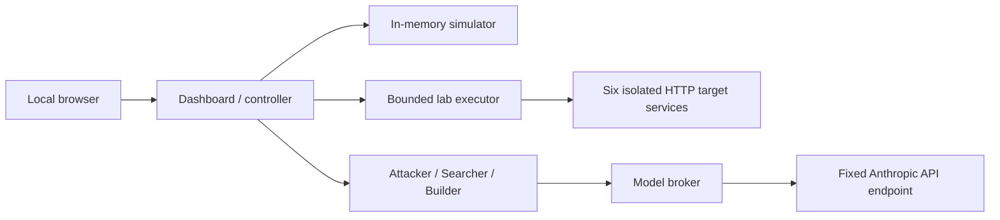

# VortexAI — cloud security lab

HackRPI 2026 · Cloud · Alex & Vaibhav

VortexAI is a local learning platform for exploring cloud-security weaknesses. Watch traffic in an interactive 3D map, run bounded attacks, inspect evidence, approve a proposed fix, and replay the attack to see whether the fix works.

The platform combines **Attacker**, **Searcher**, and **Builder** roles with an in-memory simulator and an optional isolated Docker service lab. AI decisions are validated against permitted actions; unavailable or invalid model responses produce an explicit **FALLBACK** result. The application does not connect to an AWS, Azure, or GCP account.

## Run instructions

### 1. Open the project in the correct terminal

On Windows, open **PowerShell** in the repository folder. Install **Node.js 24 or newer**, including npm, then run:

```powershell
cd .\source
node --version
```

The version must be `v24.x.x` or newer. If your terminal is already in `source`, skip the `cd` command. All application commands run inside **`source/`**, which contains `package.json`, `compose.yaml`, and the Dockerfile. There are no third-party npm dependencies to install.

For this computer, you can enter that folder directly with:

```powershell
Set-Location 'C:\Users\alexs\Documents\Business\Contest\HackRPI\11726Cloud_CloudAISecurity\source'
```

The Windows examples use `npm.cmd` to avoid PowerShell's script-execution-policy error. On Linux or macOS, use `npm` instead.

### 2. Choose how to run

**Docker lab — simulation plus real service containers**

Start **Docker Desktop** with its Linux/WSL 2 engine. Docker Engine **28+** and Compose are required. If a standalone `npm start` server is running, stop it with Ctrl+C first. Then run:

```powershell
npm.cmd run lab:up
```

This prepares `source/.env` and local control tokens, builds the current code, starts the twelve containers, waits for health checks, and verifies isolation. The first run may take several minutes and needs Internet access to download the base image. Wait for the containment-success message before selecting real services.

**The AI agents can be connected later.** No Anthropic key is required to run the platform. Leave `ANTHROPIC_API_KEY` empty in `source/.env` to use explicitly labeled rule fallback. Do not enter a key in chat or the dashboard.

**Standalone simulator — no Docker required**

This starts only the in-memory simulator and its rule fallback. If the Docker lab is running, stop it first with `npm.cmd run lab:down`; that removes its containers/networks and discards their disposable state. Then run:

```powershell
npm.cmd start
```

Keep this terminal open. Ctrl+C stops the standalone server. It cannot connect to the real-service lab. Both launch modes use port **4173**, so run only one of them on that port at a time.

### 3. Open and use the dashboard

Open **[http://127.0.0.1:4173](http://127.0.0.1:4173)**. If it was already open while you rebuilt the app, refresh the page.

1. Choose **In-memory simulation** to explore users, hidden bots, and the 3D controls. Choose **Isolated service lab** for real HTTP scenarios after Docker verification succeeds.
2. If the environment is paused, select **Resume simulation** or **Resume lab traffic**.
3. Run a scenario, review its finding, approve the offered fix, and replay the same scenario to check the result.
4. **Reset lab** restores the vulnerable baseline and leaves traffic paused. Resume before starting the next experiment.

Docker runs in the background; closing its startup terminal does not stop the lab. Standalone mode stops when its server process exits.

### 4. Check, stop, or restart

Run these from `source/` in PowerShell:

| Command | Result |
| --- | --- |
| `npm.cmd run lab:status` | Show the existing containers and their health |
| `npm.cmd run lab:verify` | Recheck isolation while the lab is running |
| `npm.cmd run lab:down` | Stop/remove the lab containers and networks |
| `npm.cmd run lab:up` | Build/start the current code and verify the lab again |
| `npm.cmd test` | Run the automated checks; does not start the dashboard |

Use **`npm run lab:status`**, not `npm lab:status`; every `lab:*` package script requires `run`. To switch from Docker to standalone, stop the lab first. To switch from standalone to Docker, stop the standalone process with Ctrl+C first.

### Using an Ubuntu/WSL terminal

Windows and WSL have separate Node installations. Check `node --version` **inside Ubuntu**; a working Windows Node installation does not upgrade Ubuntu's Node. Node 12 can fail at startup with `Unexpected token '?'`; use Node 24 or newer.

For Docker commands from Ubuntu, enable **Docker Desktop → Settings → Resources → WSL Integration → your Ubuntu distribution**, apply the change, and reopen the Ubuntu terminal. Check `docker version` and `docker compose version` there before starting the lab. See [Docker's WSL setup instructions](https://docs.docker.com/desktop/features/wsl/#enable-docker-in-a-wsl-2-distribution).

From the repository root in Ubuntu:

```sh
cd source
node --version
npm run lab:up
```

If Ubuntu reports `docker: not found` or the launcher says Docker is unavailable while Docker Desktop is running, use the PowerShell instructions above until WSL integration is configured.

## What is implemented

| Capability | In-memory simulation | Isolated service lab |
| --- | --- | --- |
| 3D topology, events, findings, approved fixes and replay | Synthetic state and events | Actual HTTP outcomes from disposable services |
| Exposed storage, credential abuse, lateral movement | Three scripted scenarios | The same three teaching scenarios |
| AI-composed attack chains | Up to eight validated catalog steps | Not supported; scripted scenarios only |
| Adjustable users and hidden bots | 1–60 users, randomized bots, suspect scoring | Not supported |
| Flood tripwire and gateway overload pause | Modeled traffic controls | Not implemented as real traffic controls |
| Node pause, observe and quarantine | Changes modeled traffic behavior | Changes service request admission; does not stop containers |
| Live model assistance | Available through the Docker-hosted dashboard in simulation mode | Available through the same agent containers |
| Standalone `npm start` | Works with deterministic rule fallback | Cannot connect to the service lab |

The perspective view is rendered with Canvas 2D using 3D coordinates. Its particles explain recorded events; they are not captured network packets. Both environments use fabricated data.

## Try the attack → fix → replay loop

1. Watch normal traffic and inspect a resource.
2. Run **Exposed storage**, **Credential abuse**, or **Lateral movement**.
3. Wait for the scenario to finish. Review the Searcher's finding, evidence, and Builder recommendation.
4. Select **Approve & apply in lab** on the recommendation.
5. Replay the same scenario. Check for blocked operations and replay validation while ordinary application access continues.
6. Inspect attack history to see completed runs and outcomes. Use the agent buttons for additional planning, assessment, and advice.

| Scenario | Weakness demonstrated | Approved fix | Limit |
| --- | --- | --- | --- |
| Exposed storage | Anonymous listing and reading of demo objects | `storagePrivate`: require authorized access | Not a real cloud bucket scanner |
| Credential abuse | Failed sign-ins followed by a known disposable password and an admin request | `requireMfa`: require a second factor | Fixed demonstration factor, not production MFA; existing sessions are not revoked |
| Lateral movement | A disposable low-privilege token reaches an overpowered application export operation | `databaseLeastPrivilege`: remove administrative export permission | Does not fix the application flaw or revoke the token |

Applying a fix and proving it are separate steps: replay validation remains pending until an observed denial names the applied control. A later successful violation can reopen a finding. **Reset lab** restores the weak starting policies, clears run history, and leaves the environment paused; choose **Resume** before continuing.

## Users, hidden bots, and overloads

These controls are available only in **In-memory simulation**:

1. Set **Users online** between 1 and 60 and optionally enable **Hide random bots among them**.
2. Select **Apply traffic**, then let traffic accumulate. Applying settings redraws the population and clears its traffic history and score.
3. Run the Searcher to identify suspects from per-client behavior.
4. Select **Reveal hidden bots** to compare its newest assessment with the hidden population. The dashboard reports caught bots, missed bots, and false alarms, and identifies model versus rule-based assessment.

Bots exhibit credential stuffing, anonymous storage scraping, or request floods. Their identities are withheld from agent context, even after the administrator reveals them. Bots are separate from the Attacker agent's scenario runs.

- The flood tripwire blocks a client when it reaches **8 gateway requests in one tick**. The block expires after the configured 20-tick window, or the administrator can lift it with **Unblock**.
- The system-wide capacity breaker pauses the simulation at **40 allowed gateway requests in a tick**. The dashboard records the cause; use **Resume** to continue.
- Increasing the population sends newcomers to the gateway together on the next tick. A jump from 10 to 60 users can trigger overload even though a steady population of 60 is supported.

These thresholds describe the teaching model, not measured production throughput or a real firewall.

## The three agents

| Role | Receives | Can do |
| --- | --- | --- |
| Attacker | Public entry-point labels, scenario/action catalog, and its own prior outcomes | Select a scenario or compose a valid simulation-only chain; the controller executes the validated choice |
| Searcher | Policy booleans, bounded evidence summaries, and per-client activity | Cite evidence, classify internal/external causes, and identify suspected clients |
| Builder | Existing findings and offered recommendations | Explain and prioritize existing fixes with internal/external labels; cannot apply them |

Findings are created by deterministic observation rules. AI assessments supplement them; they do not create arbitrary findings, patches, or executable code. Searcher summaries retain rare events and collapse repeated traffic so attack evidence is not immediately crowded out. Attack history lets the Attacker adapt its next choice after a fix.

The implementation requests `claude-opus-5-5`. Attacker requests opt into the provider fallback mechanism configured in `source/ai/anthropic.mjs`; accepted serving-model IDs are `claude-opus-5-5`, `claude-opus-5`, and `claude-opus-4-8`. When a different accepted model serves a result, the dashboard identifies it. Searcher and Builder do not request that provider fallback. This configuration does not guarantee that a particular account has model access.

**MODEL** means a provider response passed validation. **FALLBACK** means a deterministic local decision was used because credentials, services, access, or a valid response were unavailable. Provider-side model fallback and deterministic rule fallback are different mechanisms.

Agent calls happen on explicit button actions, with a 20-second provider timeout and a 2,048-token output ceiling. There is no continuous autonomous model loop, model training, or reward-learning system. Live calls may incur provider charges. See [AI implementation details](source/docs/AI.md).

## Start the Docker lab and optional live AI

Requirements: Docker Engine **28+**, Compose, and Linux containers. On Windows, use Docker Desktop with the Linux/WSL 2 engine. Node.js 24+ runs the host setup scripts. Stop a standalone simulation server first to free port 4173.

From `source/`:

```sh
npm run lab:setup
```

This creates or updates **`source/.env`**, preserving existing nonempty values and generating separate random control tokens. For live AI, edit that file locally and set `ANTHROPIC_API_KEY`. Leave it empty for deterministic fallback. Never put a real key in the tracked `.env.example`, chat, or dashboard.

| Setting in `source/.env` | Purpose |
| --- | --- |
| `ANTHROPIC_API_KEY` | Optional provider key; passed only to the model broker |
| `ANTHROPIC_MODEL` | Keep `claude-opus-5-5`, the requested model supported by current validation |
| `LAB_CONTROL_TOKEN` | Authenticates executor commands to target services |
| `LAB_EXECUTOR_TOKEN` | Authenticates dashboard commands to the executor |
| `LAB_APP_TOKEN` | Authenticates application access to internal data services |
| `AGENT_CONTROL_TOKEN` | Authenticates controller requests to agent workers |
| `AGENT_BROKER_TOKEN` | Authenticates agent requests to the broker |

The template also contains legacy `VORTEX_MODEL`; current runtime code does not read it. Configure `ANTHROPIC_MODEL` instead. `source/.gitignore` excludes `source/.env`; a `.env` at the repository root is outside that ignore file's scope.

```sh
npm run lab:up
```

This ensures local tokens exist, builds the image, starts **12 containers**, waits for health checks, and verifies containment before enabling lab traffic. Open the dashboard at [http://127.0.0.1:4173](http://127.0.0.1:4173):

- Keep **In-memory simulation** selected for users, bots, and AI-composed chains with live agent workers.
- Choose **Isolated service lab** for real HTTP teaching scenarios after verification succeeds.

After changing the key or environment configuration, rerun `npm run lab:up`. A healthy container or configured key does not prove inference succeeded; request an agent action and inspect its **MODEL/FALLBACK** result.

| Command, from `source/` | Purpose |
| --- | --- |
| `npm start` | Start the standalone simulator |
| `npm test` | Run the Node built-in test suite |
| `npm run lab:setup` | Prepare local environment values and tokens |
| `npm run lab:up` | Build, start, wait for health, and verify the lab |
| `npm run lab:status` | Show container status |
| `npm run lab:verify` | Recheck live isolation and renew the traffic gate |
| `npm run lab:down` | Stop and remove the lab containers/networks |

### Architecture and containment



The 12 containers are the dashboard, executor, six targets (`gateway`, `lb`, `app`, `storage`, `iam`, `db`), three agents, and model broker. The database and storage services use disposable SQLite data.

Only the dashboard publishes a host port, bound to `127.0.0.1:4173`. Targets, executor, and agents use internal isolated networks. The broker has a separate outbound network and is the sole model-key holder. The trusted dashboard also has an external route via its frontend bridge; the broker is not the only container with any outbound route.

The verifier checks actual running containers, network membership, resource limits, unprivileged execution, read-only filesystems, and selected network paths. Targets cannot receive arbitrary URLs, shell commands, or model-generated code. These checks cover the configured teaching lab, not arbitrary exploits or kernel/container escapes. Read the [service-lab guide](source/docs/REAL-LAB.md) for detailed boundaries.

## Dashboard controls

| Gesture | Action |
| --- | --- |
| Left/middle drag | Orbit 360° horizontally and vertically; vertical motion is reversed |
| Shift + left/middle drag | Pan |
| Mouse wheel | Zoom |
| Ctrl + click | Toggle node selection |
| Ctrl + left drag | Move a node or selected group on its horizontal plane |
| Alt + left drag | Box-select node centers |
| Right click a selected node | Open shared information and status/action settings |
| Ctrl + right drag | Move selected nodes without changing their height |
| Escape during a drag | Cancel and restore prior selection/positions |

Use **Inspect resource → Edit selected** for keyboard access. **Reset view** resets the camera; **Reset layout** resets node positions. Layout is saved in browser local storage separately for each environment and does not change connectivity. Operational controls remain server-owned. Group updates apply sequentially and report partial success if a later update fails.

In service mode, only the six real targets support operational edits. Pause/quarantine denies ordinary requests while health and authenticated control routes remain available. Observe annotates telemetry. These controls do not stop Docker processes or modify network isolation.

## HTTP API

The dashboard serves a local API with Host/Origin checks, bounded JSON bodies, and explicit routes. Mutations use `POST` with `Content-Type: application/json`; unexpected fields are rejected. Successful mutations return updated state.

| Route | Method / body | Purpose |
| --- | --- | --- |
| `/api/state` | `GET` | Environment, events, findings, agent results and traffic state |
| `/api/findings` | `GET` | Shared finding-format adapter; not a durable audit archive |
| `/api/scenario` | `POST {"id":"exposed-storage"}` | Run one of the three scenario IDs |
| `/api/recommendation` | `POST {"id":"<offered recommendation ID>"}` | Approve an existing fix |
| `/api/running` | `POST {"running":true}` | Resume or pause |
| `/api/reset` | `POST {}` | Reset the current environment and pause it |
| `/api/node` | `POST {"id":"storage","status":"active","action":"observe"}` | Change operational settings |
| `/api/mode` | `POST {"mode":"simulation"}` or `{"mode":"lab"}` | Switch environments |
| `/api/ai/run` | `POST {"agent":"searcher"}` | Run `attacker`, `searcher`, or `builder` |
| `/api/traffic` | `POST {"users":10,"bots":true}` | Configure simulator traffic |
| `/api/bots/reveal` | `POST {}` | Reveal bots and calculate the Searcher score |
| `/api/unblock` | `POST {"clientId":"<blocked client ID>"}` | Lift a simulator client block |

## Tests and verification

From `source/`:

```sh
npm test
# Equivalent without npm:
node --test
```

The reviewed implementation passed **158 tests on November 7, 2026** with Node.js 24.22.1 and local loopback connections enabled. Coverage includes scenario/fix/replay behavior, composed chains, agent context redaction and response validation, model fallback, HTTP boundaries, container-inspection rules, service handlers with injected transports, traffic scoring/overload, and dashboard interaction math.

Tests make no paid model requests. Passing them does not certify live model access, a deployed Docker network, or visual behavior in every browser. Re-run tests after changes and run `npm run lab:verify` on the machine hosting the lab. See [the service-lab guide](source/docs/REAL-LAB.md#data-tests-and-verification-status) for historical live-check context.

## Troubleshooting

| Symptom | What to check |
| --- | --- |
| npm cannot find `package.json` | Run commands from `source/`, not the repository root |
| PowerShell blocks `npm.ps1` | Use `npm.cmd` or `node server.mjs` / `node --test` |
| Port 4173 is already in use | Stop the existing standalone server or lab before starting the other |
| Docker unavailable or unhealthy | Start the Linux Docker engine; check `npm run lab:status` and Engine 28+ |
| Containment verification fails | Read the failing check; ensure `172.30.40.0/24`–`172.30.42.0/24` do not conflict. Update Compose and verifier together if changing wiring |
| Lab traffic remains locked | Run `npm run lab:verify`; do not bypass the verification marker |
| Agent result says FALLBACK | Confirm `source/.env`, restart via `npm run lab:up`, and check provider access; standalone mode always uses rules |
| A scenario will not start | Finish the current operation and resume after reset/pause; paused service mode rejects new scenarios |
| Simulation paused after adding users | Review the overload message and select Resume; a large arrival burst can exceed capacity |
| Tests report local `EACCES` connections | Run in an environment that permits the tests' local HTTP servers |

## Project map

| Location | Purpose |
| --- | --- |
| [source/server.mjs](source/server.mjs) | HTTP routes, input validation, static assets and startup |
| [source/src/simulation.mjs](source/src/simulation.mjs) | Topology, action catalog, scenarios, policies and evidence rules |
| [source/src/traffic.mjs](source/src/traffic.mjs) | Users, bots, per-client observations and flood/overload controls |
| [source/src/runtime.mjs](source/src/runtime.mjs) | Environment switching, agent orchestration, locks and attack history |
| [source/src/findings.mjs](source/src/findings.mjs) | Shared finding export adapter |
| [source/ai/](source/ai/) | Context filtering, decision validation, agent workers and broker |
| [source/lab/](source/lab/) | Executor, HTTP services, network probes and live-check helper |
| [source/compose.yaml](source/compose.yaml), [source/Dockerfile](source/Dockerfile) | Container topology and image |
| [source/scripts/](source/scripts/) | Token setup, Docker lifecycle and live containment verification |
| [source/public/](source/public/) | HTML/CSS, rendering and grid controls |
| [source/test/](source/test/) | Node test suite and scenario regression fixture |
| [source/docs/AI.md](source/docs/AI.md) | Agent interfaces, provider handling and trust boundaries |
| [source/docs/REAL-LAB.md](source/docs/REAL-LAB.md) | Detailed Docker setup and limitations |
| [source/docs/ARCHITECTURE.md](source/docs/ARCHITECTURE.md) | Historical simulation baseline; read its current-status note first |
| [docs/](docs/) | Project notes and historical design prompts, not executable specifications |

Production modules contain overview and targeted function comments explaining state ownership, validation, boundaries, and interaction behavior. Tests document expected behavior through named cases. When adding features, update relevant comments and this README's mode comparison, commands, and limits.

## Current limits and future work

- Events, findings, agent results, and attack histories are bounded in-memory views. There is no durable audit archive or report-download workflow. All dashboard tabs share the selected server environment; browser layout is stored separately.
- Only three scripted weaknesses and their fixed policy remedies are supported in the real lab. Simulation chains reuse the action catalog rather than inventing new exploit capabilities.
- The broader roadmap includes generated environments, seeded hardened/default/sloppy variants, multi-run campaigns, additional techniques, configuration precision/recall, risk correlation, and before/after breach-rate charts. The existing hidden-bot score is narrower than those campaign evaluations.
- Production cloud connectors, remote multi-user deployment/authentication, arbitrary patch generation, and autonomous training are not implemented. The dashboard is designed for local use.
- The repository currently has no checked-in CI workflow or license file. Local tests and historical verification notes are not continuous deployment checks.

The files in [docs/prompts/](docs/prompts/) describe earlier plans. Current behavior is defined by the implementation and tests, with this README as the project entry point.
