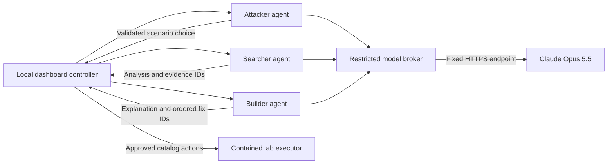

# Claude Opus 5.5 agent integration

VortexAI uses the requested Anthropic model ID `claude-opus-5-5`. The three roles run as separate services and communicate through the platform. They do not call each other or execute model-written commands.

The prompt documents in `prompts/` supply the role split, evidence discipline, legal-action menu, and administrator approval requirements. Their older OpenAI-only and simulation-only constraints are superseded by the user's request for Claude and a contained real-service lab. This implementation extends the working Node application rather than claiming that the Python/FastAPI modules described in those planning documents exist. The deterministic detector remains independent from AI advice.

## Trust boundaries

Only the broker receives `ANTHROPIC_API_KEY`. No target service, agent, browser, event record, or prompt receives it. Requests always use `https://api.anthropic.com/v1/messages`; redirects and caller-supplied destinations are rejected. The broker has no generic proxy endpoint, shell, tool execution, or arbitrary file access API. Network isolation is supplied by Compose and verified separately; these application checks alone are not an escape-proof container boundary.

The Attacker receives public resource identifiers and three legal scenario choices, not hidden policies, private resources, findings, or `_ground_truth`. Searcher receives a bounded configuration and event view, excluding attack-color labels, raw bodies, credentials, and log detail strings. Builder receives at most eight findings and twelve offered recommendations. It can order existing fix IDs and explain tradeoffs; it cannot invent or apply patches.

All model responses use a strict JSON schema and undergo independent checks for role authority, identifier membership, size, and shape. The output fields are `summary`, `scenarioId`, `evidenceIds`, and `recommendationIds`. Even a syntactically valid model response cannot supply a URL or command as an action. Model prose remains advisory and can be wrong; it is never a substitute for observed evidence or a verified replay.

## Configuration

- `ANTHROPIC_API_KEY`: configure locally for the broker only; never paste it into chat or commit it.
- `ANTHROPIC_MODEL`: `claude-opus-5-5` (the only model accepted by this integration).
- `AGENT_CONTROL_TOKEN`: generated random token of at least 24 characters, shared only by the controller and agent services.
- `AGENT_BROKER_TOKEN`: a different generated token of at least 24 characters, shared by agents and broker.
- `AGENT_ROLE`: one of `attacker`, `searcher`, or `builder` per agent container.

The model is invoked only on an explicit agent action, with one request, a 20-second timeout, and a 2,048-token output ceiling. There is no autonomous retry loop. API usage may incur Anthropic charges. The broker sends only bounded fictional lab metadata, not host files or production credentials.

Missing credentials, unavailable services, refusals, timeouts, incomplete replies, or invalid IDs produce an explicitly labeled deterministic fallback. A fallback result does **not** establish that a live model was reached. Live activation requires a valid Anthropic key with access to the selected model and a running container environment.

## Interfaces

| Component | Route | Authentication | Response |
| --- | --- | --- | --- |
| Each agent | `POST /run` with `{context}` | Bearer `AGENT_CONTROL_TOKEN` | Validated role result |
| Broker | `POST /infer` with `{agent, context}` | Bearer `AGENT_BROKER_TOKEN` | Model or fallback result |
| Agent/broker | `GET /health` | Internal network only | Liveness; broker also reports whether a key is configured |

The result includes `agent`, `mode` (`model` or `fallback`), `provider`, `model`, the four decision fields, and a safe fallback reason where applicable. A configured key or successful health response is not a successful model inference.

## Verification

`node --test test/ai.test.mjs` verifies role redaction, repeated boundary sanitization, catalog validation, exact model selection, HTTP request construction, missing-key behavior, refusal/timeout fallback, bounded responses, token checks, and the distinction between model and fallback modes. Provider responses are mocked; these tests make no paid API call.

Official references checked for this implementation: [Opus 5.5 model ID](https://platform.claude.com/docs/en/models/opus-5-5/overview), [structured outputs](https://platform.claude.com/docs/en/build-with-claude/structured-outputs), and [API version 2026-10-21](https://platform.claude.com/docs/en/api/versioning). The request deliberately omits `temperature`, which is not accepted by that API version.
