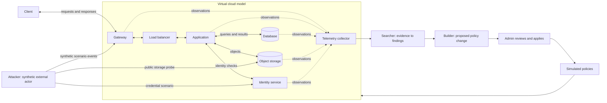

# VortexAI: cloud security simulation

VortexAI is a provider-neutral model of a small cloud application. It generates normal traffic and bounded attack scenarios, shows their paths in a rotatable 3D view, detects suspicious observations, and proposes changes for an administrator to apply and retest.

The current environment is an in-memory simulation. Its services, credentials, data, and attacks are JavaScript state and events. It does not provision cloud resources, capture packets, run exploit code, or create virtual machines. The three agents currently use explicit rules, rather than trained models or an external AI service.

## How normal cloud traffic works

This is a simplified application topology, not a mandatory layout for every cloud. In a typical application, a client sends a request through an edge gateway and load balancer to an application. The application checks identity and accesses authorized database records or objects; responses travel back to the client. On each tick, the prototype emits the inbound request chain, an alternating database/storage read and response, the return path through application, load balancer, gateway, and client, and an application audit event. Identity checks are conceptual topology connections rather than additional baseline events. Storage can have a separate public service endpoint, so its exposure is modeled separately from the application gateway.

Solid application paths represent service interactions in the model's topology. Dotted paths represent observations, not extra application requests. The collector represents the event buffer and observation pipeline: every emitted event goes directly to Searcher in the same process. Attacker reports scenario progress and outcomes; all current findings and Builder recommendations pass through Searcher's rules. The browser receives snapshots from the local simulator; its animated particles explain those events, not captured network packets.

The **data plane** carries application requests and data. The **control plane** manages identity, permissions, configuration, and resource changes. A request to change a storage policy belongs to the control plane even if it uses the same network protocol as a normal object read. Telemetry observes both planes and should preserve that distinction.

Real cloud flow logs describe traffic metadata, including source, destination, and protocol. They are often aggregated records rather than individual packets; AWS documents this explicitly in its [flow-log record format](https://docs.aws.amazon.com/vpc/latest/userguide/flow-log-records.html). This prototype uses one event per modeled operation for a clearer demonstration.

## The three-agent loop

| Agent | Reads | Produces | Authority in this prototype |
| --- | --- | --- | --- |
| Attacker | A named scenario and its modeled outcomes | A bounded sequence of synthetic actions | Can address only predefined virtual nodes; cannot issue attack network requests |
| Searcher | Observed event fields and recent evidence | A finding with severity, affected node, and evidence IDs | Observes; does not silently modify policies |
| Builder | Diagnosed findings and known policy remedies | A concrete recommendation and its tradeoff | Proposes; the administrator applies the change |

1. Let baseline traffic run and inspect the paths.
2. Select an attack scenario. Its actions pass through the model's current policy checks.
3. Searcher evaluates the resulting observations. Scenario names and visual attack colors are not sufficient evidence for a finding.
4. Builder associates a diagnosed weakness with a policy recommendation.
5. After the scenario finishes, the administrator reviews the change and its tradeoff, then applies it inside the model. Policy changes are rejected while a scenario is active, including when paused.
6. Replay the scenario. Compare allowed and blocked actions, and confirm legitimate traffic continues.

Applying a recommendation changes only simulated policy state. The associated finding is marked resolved when the control is applied, while the recommendation's validation remains pending until a denied observation names that applied control. A blocked replay demonstrates that this modeled path is mitigated; it does not prove a real cloud deployment secure. Keeping blocked attempts visible also avoids confusing prevention with an absence of attempted attacks.

## Initial scenarios

| Scenario ID | Modeled weakness and path | Searcher evidence | Builder direction | Retest goal |
| --- | --- | --- | --- | --- |
| `exposed-storage` | Discovery, followed by anonymous storage listing and reading | An allowed `list-objects` or `read-object` operation by an unauthenticated `anonymous` principal | Set `storagePrivate`: deny anonymous access while retaining application service access | Listing and reading are denied; ordinary application reads continue |
| `credential-abuse` | Three failed sign-ins, then a stolen-password sign-in and administrator request | An allowed password sign-in after at least three failures for the same source/principal within 12 ticks | Set `requireMfa`: require a second factor for interactive sign-in | The password-only session and subsequent administrator request are denied; ordinary application traffic continues |
| `lateral-movement` | Assumes a stolen low-privilege application token and an application flaw that invokes its overpowered service identity; then attempts database export | An allowed `admin-export` to the database by `app-service` | Set `databaseLeastPrivilege`: remove administrative export permission but preserve ordinary reads | Export is denied and audited; the stolen token and application flaw are still outside this remedy |

MFA here blocks only the modeled password-only path; stolen sessions and MFA bypass are not modeled. Least privilege limits the database impact without revoking the stolen application token or repairing the assumed application flaw. Controls are applied between completed scenarios so baseline and replay outcomes remain distinct.

These are intentional weaknesses in a synthetic model. The scenarios do not contain reusable exploit payloads, contact public targets, or search the host computer. Their repeatability makes before-and-after demonstrations and regression tests possible.

## State and telemetry contract

The simulator owns nodes, display topology edges, policies, queued scenario actions, recent events, findings, and recommendations. Display edges describe normal service relationships; scenario code can emit additional modeled paths between predefined nodes. The browser reads snapshots and requests named operations. It should never supply arbitrary executable code or a target URL.

| Event field | Meaning |
| --- | --- |
| `id` | Stable identifier used by finding evidence |
| `tick`, `time` | Simulation step and display timestamp |
| `source`, `target` | IDs of predefined virtual nodes |
| `protocol` | Displayed protocol for the modeled operation |
| `action` | What the actor attempted |
| `outcome` | What the policy model allowed or rejected |
| `bytes` | Synthetic amount of transferred data |
| `kind` | Presentation category: normal, attack, or blocked |
| `principal`, `authenticated`, `authentication` | Observed identity, authentication status, and optional method |
| `control` | Optional policy key connecting a denied operation to a modeled control |
| `detail` | Human-readable observation |

`kind` helps the visualization explain known simulation ground truth and is removed before Searcher receives an observation. Searcher derives detection from action, outcome, identity, and recent failures. Denied events can validate a control but do not themselves create weakness findings. Findings retain up to eight evidence copies as well as their IDs; recommendations identify a policy key, application state, and replay validation. The activity feed retains the latest 160 events, so it is a demonstration view rather than a permanent audit archive.

For a future runtime environment, combine flow observations with authentication and configuration audit logs. Application traces connect requests across services; metrics describe rates and volumes; logs carry discrete observations. [OpenTelemetry's signal model](https://opentelemetry.io/docs/concepts/signals/) provides the vocabulary for this extension. Network metadata alone cannot reliably establish intent or explain every identity and configuration change.

## Environment phases

### Phase 1: the implemented local model

- Run the local application with the project's documented start command.
- Use a browser on the same machine to explore the topology and scenario controls.
- Keep agents restricted to predefined actions and node IDs. No cloud account, secret, or paid resource is required.
- Use reset for a fresh demonstration; state is held in memory rather than deployed to infrastructure.
- Test normal traffic, each vulnerable scenario, admin application, and blocked replay.

### Phase 2: an optional isolated service lab

Replace the virtual nodes gradually with small disposable services and a synthetic dataset. Keep the existing event contract so the 3D view and agent workflow can consume normalized observations. This phase is a design proposal; the current project does not deploy these services.

For actual attack execution, establish containment before starting an agent: use a dedicated disposable VM, network namespaces, an internal lab network, explicit egress denial, and restricted host access. Do not give the lab production credentials, the container engine socket, privileged mode, host networking, or mounts of personal folders. Limit resources and allow only named scenarios and lab targets.

Docker documents that an [internal network](https://docs.docker.com/reference/cli/docker/network/create/) removes the default route and installs rules against other networks. That setting is one control, not a complete host-isolation guarantee: validate host reachability and egress independently, and avoid a second network attachment that restores outside access. Check both IPv4 and IPv6 and include the collector in the containment design.

A score penalty after an escape does not provide containment. Prevention must be enforced by the execution environment, with an external stop mechanism and monitoring. Reject an out-of-scope action before execution.

### Phase 3: AI-assisted decisions

Add a model through a narrow agent interface after the deterministic loop is reliable. Give Attacker an allowlisted action catalog, Searcher read-only telemetry, and Builder a typed recommendation schema. Keep authorization and execution in ordinary application code. Treat log text and model output as untrusted data, validate every requested action, and retain explicit administrator approval for policy changes.

Evaluate on held-out scenario variations: detection delay, false positives on normal traffic, evidence quality, excessive privileges removed, legitimate requests preserved, and whether replay is prevented. A reward can encourage useful discoveries inside the allowed model; it must never override the boundary checks.

## Demonstration success criteria

- Normal traffic animates through the expected service paths and creates no attack findings.
- Each scenario produces inspectable observations and a relevant diagnosis.
- Each recommendation states the proposed change and its effect on legitimate use.
- Only an administrator action changes the simulated policy.
- Replaying a mitigated scenario shows blocked operations while normal traffic continues.
- The interface clearly identifies the environment as simulated and the agents as rule-based.
