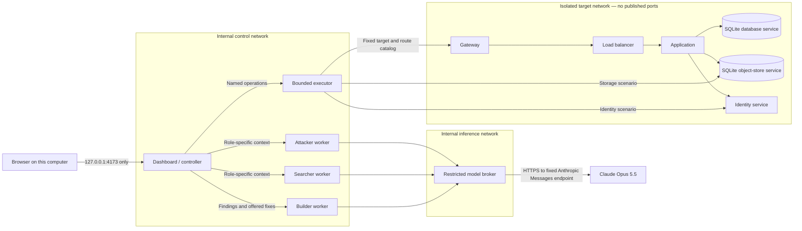

# VortexAI service lab and AI agents

This stage adds a disposable Docker lab to the existing in-memory simulation. Its six target services handle actual HTTP requests; the database and object-store services execute fixed queries against fabricated SQLite data. Three separate agent containers use a restricted model broker for Claude Opus 5.5. The dashboard can switch between synthetic traffic and real service observations.

This is a purpose-built teaching cloud, not AWS/Azure/GCP, a general exploit environment, or packet capture. Only the three implemented scenarios can run. No model output is executed as code.

## Start the lab

Use Node.js 24 for the full local test suite and management commands. The container image also uses Node 24. On Windows, install and start Docker Desktop with its Linux-container/WSL 2 backend. Docker Engine **28 or newer** and the Compose plugin are required; the verifier rejects older engines because this topology uses isolated bridge gateways.

From the project folder:

```sh
npm run lab:setup
```

This creates or updates `.env`, preserves an existing provider key, and generates five independent control tokens. Open `.env` locally and fill in the key field:

```dotenv
# Replace the placeholder locally; do not copy it as a working credential.
ANTHROPIC_API_KEY=YOUR_ANTHROPIC_API_KEY
ANTHROPIC_MODEL=claude-opus-5-5
```

Leave `ANTHROPIC_API_KEY` empty to use the explicitly labeled deterministic fallback. No API key has been supplied with this implementation, so a live model response must still be verified with your account. Never put the key into a chat, browser field, screenshot, or committed file. `.env` is ignored by Git and excluded from the image build context; only the `model-broker` service receives the provider credential.

Stop an existing `npm start` process first so port 4173 is free, then run:

```sh
npm run lab:up
```

The command prepares tokens, validates Compose configuration, builds the local image, starts all services, waits for their health checks, and runs containment verification. The initial image download needs Internet access from Docker on the host. That provisioning step is separate from the targets' runtime networks.

Open [the local dashboard](http://127.0.0.1:4173), then choose **Isolated service lab**. Real-service mode and attack traffic remain gated until verification passes. If verification fails, read its named failure and fix the configuration; do not remove the gate or create the verification marker manually.

Useful commands:

```sh
npm run lab:status
npm run lab:verify
npm run lab:down
```

`lab:verify` first revokes the earlier verification marker and then checks the live containers again. Run it after any runtime or network change. `lab:down` removes this Compose project's containers and networks. Stop and restart the lab after changing `.env` so the services receive the new values. If PowerShell blocks `npm.ps1`, use `npm.cmd` instead of `npm`.

## Trust boundaries and traffic paths

Compose starts **12 containers**: dashboard, executor, six targets, three agents, and model broker. The telemetry node in the 3D view represents collected service observations; it is not a thirteenth collector container.



| Network | Attached services | Boundary |
| --- | --- | --- |
| `frontend` | Dashboard | Non-internal ingress bridge required for loopback publishing; only dashboard port 4173 is published to host loopback |
| `control` | Dashboard, executor, three agents | Internal isolated bridge; executor listens on its control interface |
| `targets` | Executor, gateway, load balancer, application, storage, identity, database | Internal isolated bridge; targets have no external network attachment or host-published service sockets |
| `inference` | Three agents, model broker | Internal isolated bridge; agents can request structured decisions |
| `model_egress` | Model broker only | Separate non-internal bridge; broker code sends model requests only to the fixed Anthropic endpoint |

Targets cannot call the broker through their network membership. The executor bridges the control and target roles through its finite operation API; IP forwarding is disabled. The trusted dashboard also has an outbound route through its frontend network, so the broker is not the only container with any external route. It is the sole model caller and key holder. Targets, executor, and agent workers remain attached only to internal isolated networks. The broker is not a generic proxy: requests cannot provide a destination URL, redirect target, tool command, or shell operation. Its external access exists to contact the model provider, not to run attacks. Sanitized, bounded lab context leaves the computer during successful AI requests.

Docker's `internal` setting alone can leave a host bridge address reachable. The target, control, and inference bridges additionally use `gateway_mode_ipv4: isolated`, which removes that bridge address. See Docker's [gateway-mode documentation](https://docs.docker.com/engine/network/port-publishing/#gateway-modes).

## What the containment verifier checks

`scripts/lab-verify.mjs` inspects actual Docker state rather than trusting the YAML alone. It requires the exact service set, commands, networks, resource limits, and loopback-only dashboard binding. Every service runs as UID/GID 1000 with a read-only root filesystem, all Linux capabilities dropped, `no-new-privileges`, disabled forwarding/IPv6, and temporary `/tmp` storage with `noexec`/`nosuid`. There are no privileged containers, host network/PID/IPC namespaces, Docker sockets, host folder mounts, host devices, or persistent data volumes.

The verifier also runs probes in the confined namespaces. They check for absent default routes and disabled IPv6, require a positive internal-service connection, and test a small fixed set of representative Internet, cloud-metadata, and host endpoints. Only a complete pass writes the temporary marker that enables the executor's traffic operations. An executor restart/recreation requires verification again.

These checks establish the intended configuration and test selected network paths. They do **not** prove absolute containment against kernel vulnerabilities, Docker compromise, malicious host administration, or arbitrary new exploit code. The current services and action catalog intentionally avoid arbitrary code execution. If future work adds untrusted payloads or a general exploitation engine, first put the entire lab in a separate disposable VM with independently enforced host and egress boundaries. An agent score penalty after an escape is not a containment mechanism.

## Real scenarios and fixes

| Scenario | Actual lab behavior | Approved change | Replay |
| --- | --- | --- | --- |
| Exposed storage | Anonymous HTTP requests list/read fabricated objects stored in SQLite | Set `storagePrivate` on the storage service | Anonymous requests receive 403; authorized application access continues |
| Credential abuse | Three fixed incorrect demonstration passwords, then the known disposable lab password, followed by an admin request | Set `requireMfa` on the identity service | Password-only sign-in is denied; no new session authorizes the request |
| Lateral movement | A known disposable low-privilege token invokes the application's intentionally overpowered export endpoint | Set `databaseLeastPrivilege` on the database service | Administrative export is denied; ordinary reads remain available |

The second factor is a fixed demonstration value, not a production MFA implementation. The lateral-movement fix reduces the service role's privilege; it does not repair the application's business-logic flaw or revoke a stolen token. No scenario accepts an arbitrary target, user-supplied password list, shell command, SQL payload, or external exfiltration destination.

The executor records handled HTTP observations and their returned status. The dashboard's particles explain those operations; they are not individual captured packets. Normal requests are generated on a timer only after the gate is open. Pause controls background lab traffic; paused real-service mode rejects a new scenario until resumed. Reset restores the target services' intentionally weak policies and fabricated data.

## How the three AI agents work

The configured model is **Claude Opus 5.5**, API ID `claude-opus-5-5`, as listed in the [official model documentation](https://platform.claude.com/docs/en/models/opus-5-5/overview). This implementation deliberately accepts that exact model ID. It does not silently substitute another model.

| Role | Model input | Allowed output and effect |
| --- | --- | --- |
| Attacker | Public resource labels and the three legal scenario choices | A catalog scenario ID and explanation; the controller may execute that one bounded scenario |
| Searcher | Three policy booleans and up to 40 sanitized event observations | An assessment citing supplied event IDs; no resource changes |
| Builder | Existing findings and unapplied recommendation options | An explanation and ordering of existing recommendation IDs; no automatic application |

Each role is a separate worker. Workers do not call one another; the controller gathers state and dispatches individual requests. Only the broker holds the Anthropic key and calls the provider. It requests a JSON-schema response using `output_config.format`, following Anthropic's [structured-output interface](https://platform.claude.com/docs/en/build-with-claude/structured-outputs). Ordinary code then revalidates role permissions and all chosen IDs. JSON validity alone never grants authority.

The deterministic detector still creates the authoritative evidence-linked findings and fixed remediation catalog. Model assessments are additional explanations and selections, not a replacement for observed evidence. Unknown scenario, evidence, or remediation IDs are rejected. Ground truth, raw response payloads, credentials, and the simulator's attack-color labels are not included in agent context. Text is treated as untrusted data.

Calls have a 20-second provider deadline, bounded request/response sizes, and one-at-a-time broker execution. Missing keys, unavailable services, refusals, timeouts, incomplete output, and invalid decisions use the visible **FALLBACK** path. Only a validated provider result is labeled **MODEL**. Container readiness or a successful health check does not prove that your Anthropic account can use the model.

In the dashboard, use **Plan & run scenario**, **Analyze observations**, and **Propose improvements**. Review the returned mode and explanation. Use **Approve & apply in lab** on a recommendation only after the scenario finishes, then replay it. The application waits for the real service to acknowledge a policy change before recording it as applied.

## Grid interaction

| Gesture | Result |
| --- | --- |
| Left or middle drag | Full 360° orbit in both directions, with reversed vertical mouse movement |
| Shift + left/middle drag | Pan the camera |
| Mouse wheel | Zoom |
| Ctrl + left click | Add/remove a node from selection |
| Ctrl + left drag a node | Move it on the horizontal X/Z plane; dragging a selected node moves the whole group |
| Alt + left drag | Draw a selection rectangle around node centers in any direction |
| Right click a selected node | Open shared information and status/action dropdowns for the selection |
| Ctrl + right drag a node | Also move the selected group, preserving each node's height |
| Escape during a drag | Cancel and restore the previous positions or selection |
| Inspect resource → Edit selected | Keyboard-accessible details and position editing |

Positions are bounded to the displayed lab area and stored in this browser, separately for each environment. They do not change service addresses, connections, or cloud routing. **Reset view** restores the camera; **Reset layout** restores node positions. Camera rotation has no vertical angle limit. At an exactly edge-on view, a pointer ray may not intersect the movement plane; orbit slightly to move nodes in that case.

Box selection replaces the previous selection. Ctrl-click adds/removes individual nodes afterward. Ctrl-drag on an unselected node moves that node alone; Ctrl-drag on a selected node preserves and moves the group. Right-clicking outside the selection opens only the clicked node. Group editors offer only controls supported by every selected resource. Mixed values remain unchanged unless you choose a replacement, and changing one field preserves each node's other field. Group updates are acknowledged one service at a time; if a request fails, the editor reports which earlier changes succeeded.

In the simulator, paused or quarantined nodes stop modeled traffic, and Observe marks it for inspection. In service mode, status/action editing is supported for the six real resource IDs: `gateway`, `lb`, `app`, `storage`, `iam`, and `db`. Paused/quarantined services deny ordinary requests while health and authenticated control routes remain available; Observe annotates actual telemetry. These are bounded service admission controls, not Docker process controls or network/firewall changes. Restore Active/Normal to resume ordinary request handling. The user, attacker, and telemetry visualization nodes remain read-only for operational controls, but all node positions remain editable. Security-policy fixes still use reviewed Builder recommendations.

## Relationship to the prompts

All four documents under `prompts/` were read as the team's design reference. Their independent-agent roles, restricted attacker view, evidence references, fixed remediation menu, explicit fallback, and administrator approval are carried into this implementation. The newer request for real contained services and Claude Opus 5.5 supersedes their earlier simulation-only/OpenAI choices.

This stage extends the existing Node dashboard instead of replacing it with the prompt documents' proposed Python/FastAPI/Pydantic and React stack. `GET /api/findings` provides a canonical adapter with the shared finding fields (`source`, `origin`, `category`, `technique`, `resource_id`, `env_id`, `evidence`, `exploited`, `detected`, and `attack_run_id`) alongside the existing UI fields. This is not a complete implementation of the proposed environment/campaign/diagnosis schemas or route list.

Still deferred: the full 12-technique taxonomy, generated 15–30-resource environments, seeded Hardened/Default/Sloppy clones, multi-run campaigns, configuration precision/recall scoring, toxic-combination escalation, correlation/risk-score formulas, JSON Patch clone application, and before/after breach-rate charts. Only three teaching scenarios are executed in this stage. None of the deferred exploit categories is enabled by the service lab.

## Data, tests, and verification status

Tokens and the optional provider key stay in local `.env`; model credentials are passed only to the broker. Demo data is fabricated and lives in container memory or temporary SQLite files. Findings, events, sessions, and AI history are transient. Container restart/reset discards relevant state; no durable audit archive is provided. Browser layout persists independently in local storage. All dashboard tabs share the selected environment's server state.

Run `npm test` for the automated suite. It exercises scenario/fix/replay behavior, real service handlers with injected transports, model-response validation/fallback, HTTP boundaries, projection math, and verification-rule logic. These tests do not substitute for Docker's live network checks or a real provider request.

Verified on this computer on November 7, 2026: Docker Desktop is installed, Engine 29.9.2 is running, all 12 containers are healthy, and live containment checks passed for all 10 confined roles. All 102 automated tests passed, including the updated orbit, box selection, group movement, and shared editor behaviors. The real-service smoke check exercised each of the three scenarios through observed HTTP evidence, an acknowledged policy fix, and a blocked replay. It also verified real node pause/observe/restore controls and contacted all three independent agent workers. The containment checks were repeated successfully after the dashboard interaction update.

The generated `.env` has no Anthropic API key. Each agent worker correctly returned **FALLBACK**; no paid model inference has been verified. After adding your key locally, run `npm run lab:up` and request an agent action. A **MODEL** result confirms successful provider access for that request. Rerun containment verification after runtime or network changes; these recorded checks describe the tested deployment, not a permanent guarantee against arbitrary code or container escapes.

If startup fails, check Docker Desktop's Linux engine, Engine version, port 4173 conflicts, and conflicts with the three configured `172.30.40.0/24`–`172.30.42.0/24` lab subnets. The control network reserves `172.30.40.3` for the executor and allocates other containers from `172.30.40.128/25`. If changing subnet wiring is necessary, update both Compose and the verifier together and rerun verification; do not weaken the expected-network checks.
