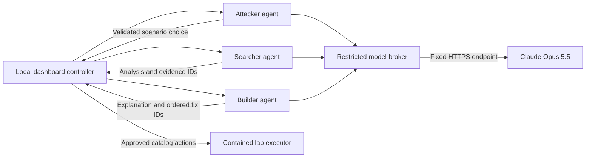

# Claude Opus 5.5 agent integration

VortexAI uses the requested Anthropic model ID `claude-opus-5-5`. The three roles run as separate services and communicate through the platform. They do not call each other or execute model-written commands.

The historical prompt documents in [Document/prompts/](../../Document/prompts/) supply the role split, evidence discipline, legal-action menu, and administrator approval requirements. The working Node application has evolved beyond those plans. The deterministic detector remains independent from AI advice. Run commands from `source/`; configure the broker in `source/.env`. See the [current README](../../README.md) for the full setup and mode comparison.

## Trust boundaries

Only the broker receives `ANTHROPIC_API_KEY`. No target service, agent, browser, event record, or prompt receives it. Requests always use `https://api.anthropic.com/v1/messages`; redirects and caller-supplied destinations are rejected. The broker has no generic proxy endpoint, shell, tool execution, or arbitrary file access API. Network isolation is supplied by Compose and verified separately; these application checks alone are not an escape-proof container boundary.

The Attacker receives public resource identifiers, three legal scenario choices, and its own attack history (scenario or composed plan and whether it succeeded or was blocked, newest first), not hidden policies, control names, private resources, findings, or `_ground_truth`. In simulation mode it also receives an action catalog and may return a chain of up to eight steps with validated prerequisite order. Real-service mode omits that catalog and accepts only scripted scenarios. Rule fallback selects scripted scenarios, favoring untried paths or paths whose latest attempt succeeded. The runtime records history from scenario observations, excluding background client events: a run is marked blocked when a denied observation names a control.

Searcher receives a bounded configuration and event view, excluding attack-color labels, raw bodies, credentials, and log detail strings. The view covers the full 160-event feed plus evidence retained on findings: identical repeated operations are collapsed into one entry with a count and up to eight citable ids, and rare operations are listed individually first, so attack evidence stays visible after normal traffic resumes. At most 48 entries are sent. Builder receives at most eight findings and twelve offered recommendations. It can order existing fix IDs and explain tradeoffs; it cannot invent or apply patches.

All model responses use a strict JSON schema and undergo independent checks for role authority, identifier membership, size, and shape. Decision fields are `summary`, `scenarioId`, `evidenceIds`, `recommendationIds`, `labels`, `suspects`, and `plan`. Only the Searcher may name suspects from the supplied client activity; hidden bot identities never enter its context. Only the Attacker may return a nonempty plan, and only when a catalog is supplied. `labels` classifies cited evidence or offered fixes as `internal` (misconfiguration/excess permissions) or `external` (outsider credential/identity abuse). Labels naming uncited items are rejected. Even valid JSON cannot grant execution authority; prose remains advisory.

Opus 5.5's cyber safeguard declines even the Attacker's fixed-menu choice. Attacker requests therefore opt into Anthropic's server-side fallback (`fallbacks: "default"`, beta `server-side-fallback-2026-07-01`), which re-runs a cyber-category decline on Claude Opus 4.8. Only text after the last `fallback` block is parsed, and the serving model must be Opus 5.5, Opus 5, or Opus 4.8. Results carry `servedBy` when a fallback model answered, and the dashboard labels those runs. Searcher and Builder requests do not use the fallback.

## Configuration

- `ANTHROPIC_API_KEY`: configure locally for the broker only; never paste it into chat or commit it.
- `ANTHROPIC_MODEL`: `claude-opus-5-5` (the only model this integration requests; Attacker declines may be answered by Anthropic's server-side fallback, Opus 4.8).
- `AGENT_CONTROL_TOKEN`: generated random token of at least 24 characters, shared only by the controller and agent services.
- `AGENT_BROKER_TOKEN`: a different generated token of at least 24 characters, shared by agents and broker.
- `AGENT_ROLE`: one of `attacker`, `searcher`, or `builder` per agent container.

The model is invoked only on an explicit agent action, with one request, a 20-second timeout, and a 2,048-token output ceiling. There is no autonomous retry loop. API usage may incur Anthropic charges. The broker sends only bounded fictional lab metadata, not host files or production credentials.

Missing credentials, unavailable services, refusals, timeouts, incomplete replies, or invalid IDs produce an explicitly labeled deterministic fallback. A fallback result does **not** establish that a live model was reached. Live activation requires a valid Anthropic key with access to the selected model and a running container environment.

## Interfaces

| Component | Route | Authentication | Response |
| --- | --- | --- | --- |
| Each agent | `POST /run` with `{context}` | Bearer `AGENT_CONTROL_TOKEN` | Validated role result |
| Broker | `POST /infer` with `{agent, context}` | Bearer `AGENT_BROKER_TOKEN` | Model or fallback result |
| Agent/broker | `GET /health` | Internal network only | Liveness; broker also reports whether a key is configured |

The result includes `agent`, `mode` (`model` or `fallback`), `provider`, `model` (the requested model), optional `servedBy` identifying the validated serving model, the seven decision fields, and a safe fallback reason where applicable. The dashboard highlights when the serving model differs from the requested model. A configured key or successful health response is not a successful model inference.

## Memory across runs

Each Claude agent starts a run with short hints from earlier runs, never with control names it would not otherwise see. The Attacker gets `earlierRuns`: which path it tried and whether it got through. The Searcher and Builder get `notes`: their own last six learning-log lines from earlier runs. Prompts tell all three that the cloud is re-randomized every run, so these are hints, not facts about the current run. This is memory, not training: the model itself never changes.

## The Hacker (no model)

`src/hacker.mjs` is a fourth, non-LLM agent that learns by trial and error in the in-memory simulator. Each attack it tries is a valid chain of catalog steps plus a pace (`fast` runs the chain in one tick, `slow` runs one part per tick) and a spread (one address, or rotating RFC 5737 `192.0.2.x` addresses). Its reward is +1 per weak spot it gets through and +1 for data, or −1 for nothing, minus 0.5 per control that blocked a step, 1 for tripping the tripwire, 0.3 for rotating addresses and 0.05 per tick. Each result moves that attack's value 35% of the way toward the reward. It repeats its best attack, and explores a variation or a fresh chain 20% of the time, or whenever nothing has a positive value. Values survive lab resets; **Forget learning** wipes them.

Containment: it can only pick step ids from the simulator's catalog, enters through the client edge like any user (so the tripwire, paused nodes and the Searcher's client view all apply), and never runs in the Docker lab. Its successes on fixed paths count against the Builder, and its attempts count toward the Searcher's flag rate.

Is it really learning? `npm run eval:hacker` runs a seeded, offline comparison (no API calls) against a control: the same Hacker with learning switched off, on the same clouds. It writes `data/hacker-proof.json`, which the dashboard shows under Agent performance exactly as measured. The honest tradeoff it shows: the learner gets through far more often, while the random control covers slightly more weak spots, because the learner repeats what pays.

For demos and recordings, `VORTEX_SEED=6 npm start` (or `VORTEX_SEED=6 npm run lab:up`) makes the sequence of clouds and the Hacker's choices repeat. Claude's answers still vary.

Each simulator reset draws three or four weak spots from six controls: private storage, MFA, least-privilege database role, account lockout, metadata protection and secret storage. The Docker lab keeps its fixed three.

## Verification

From `source/`, `node --test` runs the full suite, including role redaction, repeated boundary sanitization, composed-chain validation, suspect scoring, model selection, HTTP construction, missing-key behavior, refusal/timeout fallback, bounded responses, and token checks. Provider responses are mocked; these tests make no paid API call.

Official references checked for this implementation: [Opus 5.5 model ID](https://platform.claude.com/docs/en/models/opus-5-5/overview), [structured outputs](https://platform.claude.com/docs/en/build-with-claude/structured-outputs), and [API version 2026-10-21](https://platform.claude.com/docs/en/api/versioning). The request deliberately omits `temperature`, which is not accepted by that API version.
